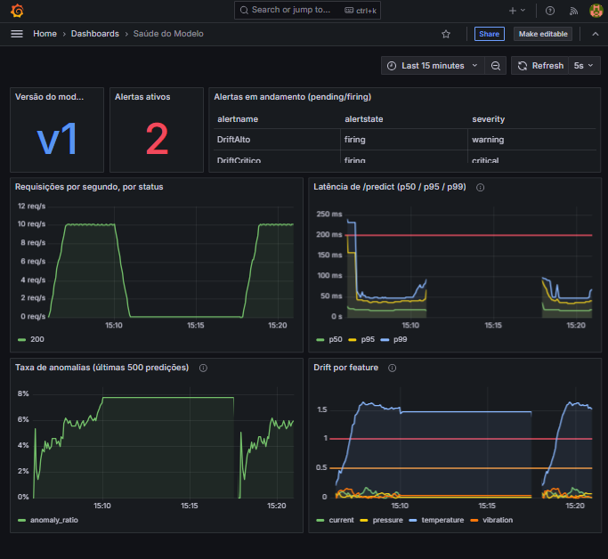
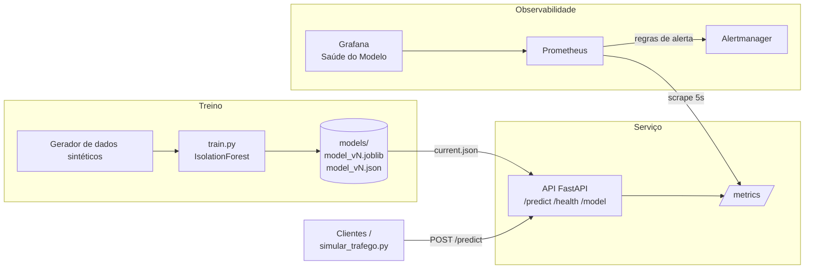
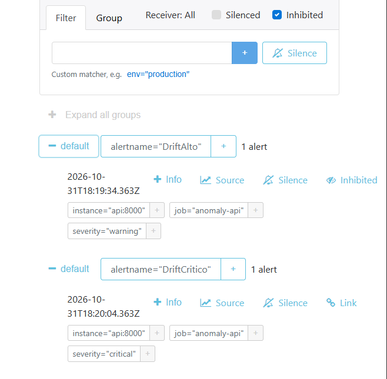
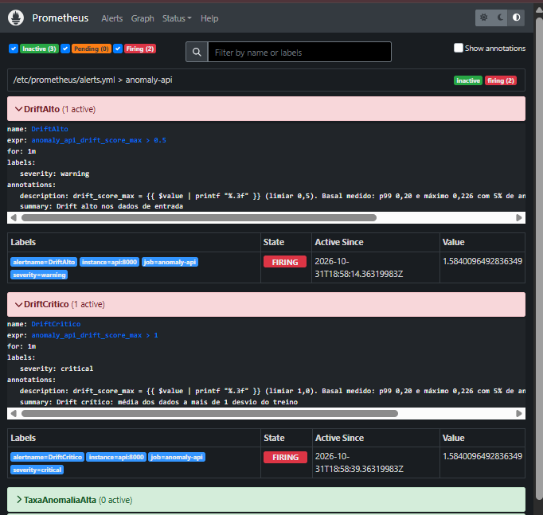

# Detecção de Anomalias como Serviço: mini plataforma de MLOps

Plataforma de MLOps de ponta a ponta construída em torno de um modelo leve de detecção de anomalias. O foco não é o modelo em si, e sim o que uma equipe de MLOps constrói ao redor dele: treino reprodutível, versionamento, serviço via API, monitoramento de desempenho e de desvio dos dados (drift), alertas e, nas próximas etapas, pipeline de CI/CD com retreino agendado e portão de qualidade.

Tudo roda localmente, inclusive num GitHub Codespace de 2 núcleos, sem nenhum provedor de IA externo e sem custo.

> ⚠️ **Aviso sobre os dados**
> Todos os dados deste projeto são **sintéticos**, gerados por código em `src/anomalias/data.py`. Eles simulam leituras de sensores industriais (`temperature` em °C, `pressure` em bar, `vibration` em mm/s e `current` em A) com anomalias injetadas de forma controlada. Como os rótulos das anomalias são conhecidos, é possível medir a qualidade do modelo, mas os números refletem esse cenário simulado, **não um ambiente de produção real**.

**Resumo**

- **O que é:** um detector de anomalias (`IsolationForest`, dados sintéticos) servido por uma API FastAPI e monitorado com Prometheus, Grafana e Alertmanager.
- **Drift:** nos testes com tráfego simulado, o drift subiu a ~1,5 desvio enquanto a taxa de anomalias ficou em ~5%, e só os alertas de drift dispararam.
- **Alertas:** `DriftAlto` disparou em 105 s e `DriftCritico` em 135 s, e o crítico inibiu o aviso.
- **Capacidade:** com 1 worker, 20 req/s foram sustentados por 60 s com p95 de ~41 ms no servidor; a 40 req/s mantidos por 2 min ou mais, a API deixou de completar `/predict`.
- **Detalhes:** [Achados](#achados) e [Limitações](#limitações).



*Painel Saúde do Modelo no Grafana durante uma rodada de drift: a `temperature` sobe até ~1,5 desvio (linhas de limiar em 0,5 e 1,0), a taxa de anomalias fica abaixo de 8% e `DriftAlto` e `DriftCritico` aparecem firing.*

## Objetivo

- Treinar um modelo `IsolationForest` (scikit-learn) em segundos e medir sua qualidade com precisão, recall, F1 e ROC-AUC sobre anomalias conhecidas.
- Versionar cada modelo treinado junto com seus hiperparâmetros, métricas e estatísticas de referência dos dados.
- Servir o modelo numa API FastAPI.
- Expor métricas operacionais e de modelo para o Prometheus: latência, volume, taxa de anomalias e drift.
- Visualizar a saúde do modelo no Grafana e disparar alertas pelo Alertmanager quando o modelo começar a se degradar.

## Dados sintéticos

Cada leitura tem quatro features:

| Feature | Unidade | Média | Desvio padrão |
|---------|---------|-------|---------------|
| `temperature` | °C | 70 | 5 |
| `pressure` | bar | 5 | 0,5 |
| `vibration` | mm/s | 2 | 0,4 |
| `current` | A | 15 | 2 |

Os pontos normais vêm de uma normal multivariada com **correlação leve** entre as features: temperatura acompanha a corrente (0,40) e vibração acompanha a pressão (0,30). As demais correlações ficam entre 0,05 e 0,15.

Uma fração dos pontos (`contamination`, 5% por padrão) vira anomalia, de três tipos:

- **`spike`**: uma única feature salta de 6 a 10 desvios padrão, para cima ou para baixo.
- **`out_of_range`**: de duas a quatro features saem da faixa ao mesmo tempo, de 4 a 7 desvios padrão.
- **`improbable_combo`**: temperatura alta, corrente baixa e vibração alta (3 a 5 desvios cada). Os valores isolados não são absurdos, mas a combinação contraria a correlação dos dados normais.

As estatísticas de referência para o drift (média e desvio de cada feature) são calculadas só com os pontos de treino que o modelo classificou como normais, sem usar os rótulos. Assim as anomalias não inflam o desvio de referência.

## Arquitetura



**Fluxo resumido:** o script de treino gera os dados, treina o modelo, avalia e salva uma nova versão em `models/`. O arquivo `current.json` indica qual versão está ativa. A API carrega essa versão, responde às predições e registra métricas. O Prometheus coleta essas métricas, avalia as regras de alerta e envia os alertas ao Alertmanager. O Grafana exibe tudo num dashboard provisionado automaticamente.

### Estrutura do repositório

```
src/anomalias/      geração de dados, treino, versionamento e cálculo de drift
api/                API FastAPI e métricas Prometheus
models/             artefatos versionados (model_vN.joblib + model_vN.json)
monitoring/         configuração do Prometheus, Grafana e Alertmanager
scripts/            simulador de tráfego (os scripts Bash chegam na Etapa 2)
tests/              testes com pytest
docs/img/           prints do Grafana, do Prometheus e do Alertmanager
Dockerfile          imagem da API (treina o modelo na build)
docker-compose.yml  API + Prometheus + Grafana + Alertmanager
.env.example        modelo do .env (senha do Grafana)
```

## Como rodar

### Pré-requisitos

Docker e Docker Compose. Para treinar, testar e rodar o simulador fora do container, Python 3.11.

O `devcontainer.json` instala Python 3.11, Docker-in-Docker e as dependências de **runtime** (`requirements.txt`). Pytest, httpx (usado pelo simulador) e ruff vêm de `requirements-dev.txt`: rode `pip install -r requirements-dev.txt` antes de testar ou simular tráfego.

### Subir o stack completo

Crie o arquivo `.env` com a senha do Grafana (ele está no `.gitignore` e **nunca** deve ser commitado):

```bash
cp .env.example .env   # edite e troque o placeholder por uma senha sua
docker compose up -d --build
```

O compose se recusa a subir se `GF_SECURITY_ADMIN_PASSWORD` não estiver definida. A imagem da API treina um modelo na build (seed 42, dados sintéticos), então não precisa de volume nem de treino prévio. A pasta `models/` da sua máquina **não** é montada no container: treinar localmente não altera a API em execução, e o modelo só é carregado quando a API sobe (`docker compose restart api` recarrega o modelo e zera as janelas de drift e de taxa de anomalias). O build reaproveita a camada de treino do cache do Docker; para retreinar na imagem, use `docker compose build --no-cache api`. Limites de memória: api 256m, prometheus 256m, grafana 256m, alertmanager 64m; o Prometheus guarda 2 dias de dados.

| Serviço      | Porta | Endereço local           |
|--------------|-------|--------------------------|
| API          | 8000  | http://localhost:8000/docs |
| Prometheus   | 9090  | http://localhost:9090    |
| Grafana      | 3000  | http://localhost:3000    |
| Alertmanager | 9093  | http://localhost:9093    |

No Codespaces, acesse pela aba **Ports**. No Grafana, entre com o usuário `admin` e a senha do `.env`; acesso anônimo e cadastro estão desligados. O datasource (`uid: prometheus`) e o dashboard **Saúde do Modelo** são provisionados automaticamente.

### Treinar um novo modelo

```bash
pip install -r requirements-dev.txt   # runtime + pytest, httpx, ruff
pip install -e .
python -m anomalias.train --n-samples 5000 --contamination 0.05 --seed 42
```

Cada execução cria uma nova versão em `models/` e atualiza `models/current.json` (esses modelos servem para uso local; o container tem o seu próprio). Use `--no-activate` para salvar sem ativar e `python -m anomalias.train --help` para ver todas as opções. Os artefatos de `models/` são gerados localmente e não vão para o git.

### Fazer uma predição

```bash
curl -X POST http://localhost:8000/predict \
  -H "Content-Type: application/json" \
  -d '{"temperature": 70.2, "pressure": 5.1, "vibration": 2.1, "current": 15.3}'
```

### Simular tráfego (normal e com drift)

```bash
# tráfego normal (~5% de anomalias), 60 s a 10 req/s
python scripts/simular_trafego.py --mode normal --duration 60 --rps 10

# drift gradual: temperature desliza até 1,5 desvio em 30 s (use --features current para somar outra)
python scripts/simular_trafego.py --mode drift --duration 90 --rps 10 --ramp 30 --shift 1.5

# rajada de anomalias (40%) no terço central da duração (padrão)
python scripts/simular_trafego.py --mode burst --duration 90 --rps 10 --anomaly-rate 0.4

# rajada nos últimos 200 s de uma execução de 300 s
python scripts/simular_trafego.py --mode burst --duration 300 --rps 10 --anomaly-rate 0.4 \
  --burst-start 100 --burst-duration 200
```

O simulador lê as `reference_stats` de `GET /model`, gera os registros em torno delas e, ao final, imprime enviados, erros e latência p50/p95 medida no cliente. Os parâmetros são `--url`, `--mode`, `--duration`, `--rps`, `--seed`, `--ramp`, `--shift`, `--features`, `--anomaly-rate`, `--burst-start` e `--burst-duration` (estes dois, em segundos, só valem no modo `burst`).

> **Capacidade:** cada chamada a `/predict` custa ~19 ms fixos, quase independente do tamanho do lote (o `score_samples` do scikit-learn tem overhead por árvore); lotes (até 1000 registros por requisição) custam ~0,2 ms/registro. Medido com 1 worker e o simulador na mesma máquina de 2 núcleos: 20 req/s foram sustentados por 60 s sem degradação (p95 no servidor de 41,3 ms); 40 req/s saturaram a API (p50 no servidor de 321 ms em 60 s) e, mantidos por 120 a 180 s, a API deixou de completar `/predict` (veja Resultados e Limitações). A capacidade por worker fica entre esses dois pontos medidos, sem nenhum ponto intermediário. A comparação com a versão anterior ao `score_and_label` (que saturava a 20 req/s, com p50 de 2,4 s no cliente) vem de execuções separadas e **não foi remedida** aqui.

### Rodar os testes e o lint

```bash
pytest
ruff check .
```

## Métricas expostas

Disponíveis em `GET /metrics`, no formato do Prometheus.

| Métrica | Tipo | Descrição |
|---------|------|-----------|
| `anomaly_api_requests_total` | Counter | Requisições por endpoint e status |
| `anomaly_api_request_latency_seconds` | Histogram | Latência das requisições (base para p50, p95, p99) |
| `anomaly_api_predictions_total` | Counter | Total de registros avaliados |
| `anomaly_api_anomalies_total` | Counter | Total de registros classificados como anomalia |
| `anomaly_api_anomaly_ratio` | Gauge | Proporção de anomalias nas últimas 500 predições |
| `anomaly_api_drift_score` | Gauge | Drift por feature (label `feature`) |
| `anomaly_api_drift_score_max` | Gauge | Maior drift entre as features |
| `anomaly_api_model_version` | Gauge | Versão do modelo em uso (label `version`) |

### Como o drift é medido

Para cada feature, o drift é calculado como:

```
drift = |média da janela recente − média do treino| / desvio padrão do treino
```

A janela recente contém os últimos 500 registros recebidos pela API, e as estatísticas de treino ficam salvas no `model_vN.json` de cada versão. Um valor de 0,5 significa que a média dos dados recebidos se afastou meio desvio padrão da média vista no treino.

É uma medida propositalmente simples. Ela detecta deslocamentos de média, mas não detecta mudanças na forma da distribuição, na variância isolada ou nas correlações entre features. Testes estatísticos como Kolmogorov–Smirnov ou PSI seriam evoluções naturais.

## Alertas

Definidos em `monitoring/prometheus/alerts.yml`. O Prometheus coleta e avalia as regras a cada 5 s e envia os alertas ao Alertmanager.

| Alerta | Expressão | `for` | Severidade |
|--------|-----------|-------|------------|
| `DriftAlto` | `anomaly_api_drift_score_max > 0.5` | 1 min | warning |
| `DriftCritico` | `anomaly_api_drift_score_max > 1.0` | 1 min | critical |
| `TaxaAnomaliaAlta` | `anomaly_api_anomaly_ratio > 0.15` | 2 min | warning |
| `LatenciaP95Alta` | `histogram_quantile(0.95, sum by (le) (rate(anomaly_api_request_latency_seconds_bucket{endpoint="/predict"}[1m]))) > 0.2` | 2 min | warning |
| `ApiFora` | `up{job="anomaly-api"} == 0` | 30 s | critical |

O `for` é o tempo contínuo que a expressão precisa ficar verdadeira: o alerta passa por *pending* e só vira *firing* depois dele. Por isso o disparo acontece sempre depois do cruzamento do limiar (veja Resultados).

**Inibição** (`monitoring/alertmanager/alertmanager.yml`): `DriftCritico` inibe `DriftAlto`, então só o crítico fica ativo no Alertmanager. O agrupamento é por `alertname`.



*Alertmanager com a caixa `Inhibited` marcada (e `Silenced` desmarcada): `DriftAlto` (warning, desde 18:19:34Z) aparece com o marcador `Inhibited` e `DriftCritico` (critical, desde 18:20:04Z) aparece ativo.*



*Prometheus com 2 alertas em `firing` e nenhum em `pending` (3 inativos): `DriftAlto` (regra `anomaly_api_drift_score_max > 0.5`, valor 1,584, `Active Since` 18:58:14Z) e `DriftCritico` (regra `anomaly_api_drift_score_max > 1`, valor 1,584, `Active Since` 18:58:39Z). `TaxaAnomaliaAlta` aparece com 0 ativos.*

**Limiares:** foram calibrados com tráfego normal sintético (5% de anomalias), em que o drift basal máximo medido foi 0,226 (calibração) e 0,170 (rodada de Resultados). Não há garantia de que valham para dados reais.

**Notificação:** o receiver `default` não tem integração, então os alertas só aparecem na interface do Alertmanager (http://localhost:9093). O arquivo traz um exemplo comentado de webhook do Discord; a URL do webhook é um segredo e não deve ser commitada.

## Resultados

Números medidos em 2026-10-31, sem estimativas, com **dados sintéticos**. Cada fase foi executada **uma única vez, sem variância medida** (única exceção: a carga a 40 req/s por mais de 2 min, repetida uma vez), com `--rps 10` e `--seed 123`, e o simulador rodou na mesma máquina da API.

**Ambiente:** GitHub Codespace de 2 núcleos (`nproc` = 2) e 7,9 GB de RAM, Docker 29.9.2 e Compose v2.40.3, 1 worker uvicorn.

| Componente | Versão |
|------------|--------|
| Python (container da API) | 3.11.18 |
| scikit-learn | 1.9.1 |
| numpy | 2.4.6 |
| fastapi | 0.162.0 |
| uvicorn | 0.54.0 |
| prometheus-client | 0.26.0 |
| Prometheus / Alertmanager / Grafana | v2.55.1 / v0.27.0 / 11.3.0 |

### Qualidade do modelo (conjunto de teste sintético)

*Dados sintéticos; uma execução de treino, sem variância medida.*

Modelo ativo na rodada de medição (`GET /model`):

| Versão | Precisão | Recall | F1 | ROC-AUC | Tempo de treino |
|--------|----------|--------|----|---------|-----------------|
| v1 | 0,935 | 0,960 | 0,947 | 0,9996 | 3,1 s |

Treino com 5000 amostras, 5% de anomalias e seed 42 (3500 para treino, 1500 para teste); 3325 pontos de treino classificados como normais formam a referência do drift. O tempo é o do comando `python -m anomalias.train` rodado dentro do container da API (relógio de parede, incluindo geração dos dados e gravação do modelo; 2,2 s de CPU). As métricas desse treino repetido foram idênticas às do modelo ativo. O ROC-AUC alto reflete um problema sintético fácil (veja Limitações).

### Fases com tráfego a 10 req/s

*Dados sintéticos; uma execução por fase, sem variância medida.*

| Indicador | Normal | Drift | Burst |
|-----------|--------|-------|-------|
| Configuração | 180 s | 240 s, rampa de 60 s até +1,5 desvio em `temperature` | 300 s, 40% de anomalias nos últimos 200 s |
| Duração real | 180 s | 241 s | 300 s |
| Registros enviados (erros) | 1800 (0) | 2400 (0) | 3000 (0) |
| Requisições/s (servidor) | 10,0 | 9,96 | 10,0 |
| Latência no servidor p50 / p95 / p99 | 18,6 / 41,4 / 49,3 ms | 18,4 / 38,3 / 48,1 ms | 18,3 / 37,5 / 48,3 ms |
| Latência p95 no cliente | 34,7 ms | 32,5 ms | 32,0 ms |
| Marcados como anomalia (cliente) | 4,7% | 5,7% | 27,6% |
| `anomaly_ratio` média / máxima | 4,7% / 6,0% | 5,1% / 7,6% | 24,8% / 41,4% |
| `anomaly_ratio` média sem os 60 s iniciais | 4,8% | 5,7% | 29,8% |
| `drift_score_max` média / máximo | 0,087 / 0,170 | 1,297 / 1,645 | 0,452 / 0,809 |
| `drift_score_max` média sem os 60 s iniciais | 0,086 | 1,499 | 0,505 |
| Drift no fim: temperature / pressure / vibration / current | 0,079 / 0,050 / 0,093 / 0,083 | 1,461 / 0,016 / 0,050 / 0,005 | 0,539 / 0,088 / 0,658 / 0,559 |
| Alertas disparados (segundos após o início da fase) | nenhum | `DriftAlto` em 105 s; `DriftCritico` em 135 s | `DriftAlto` em 195 s; `TaxaAnomaliaAlta` em 240 s |
| Alerta inibido | nenhum | `DriftAlto`, a partir de ~137 s | nenhum |

A latência no servidor vem do histograma `anomaly_api_request_latency_seconds` (percentis interpolados entre os buckets, só `/predict`); a do cliente é medida pelo simulador. Os tempos de disparo têm resolução de 5 s (intervalo de avaliação). No burst, a rajada começa em 100 s, então `DriftAlto` disparou 95 s e `TaxaAnomaliaAlta` 140 s depois do início da rajada. Antes de cada fase a API foi reiniciada e a ausência de alertas firing foi confirmada; houve 60 s de pausa entre as fases.

### Carga (modo normal, 1 worker)

*Dados sintéticos; uma execução por nível de carga, sem variância medida.*

| Indicador | 20 req/s por 60 s | 40 req/s por 60 s |
|-----------|-------------------|-------------------|
| Registros enviados (erros) | 1200 (0) | 2400 (0) |
| Duração real | 61 s | 65 s |
| Latência no servidor p50 / p95 / p99 | 18,6 / 41,3 / 49,7 ms | 321 / 940 ms / acima de 1 s |
| Latência no cliente p50 / p95 | 17,8 / 35,8 ms | 1505 / 4965 ms |
| Alertas firing | nenhum | nenhum (`LatenciaP95Alta` ficou *pending* por ~105 s) |

A 40 req/s por 60 s a API saturou: o simulador levou 5 s a mais que os 60 s configurados porque as requisições ficaram em fila, e só 1,9% delas ficaram acima do maior bucket do histograma (1 s). Os 20 req/s foram medidos por 60 s, não mais. O simulador divide os 2 núcleos com a API. A pausa e o restart da API ocorreram antes da fase de 20 req/s; a de 40 req/s começou logo em seguida, sem restart.

### Carga sustentada a 40 req/s (180 s)

*Dados sintéticos; duas execuções, sem variância medida.*

Rodada de fechamento do `LatenciaP95Alta`: restart da API, 0 alertas firing e `--mode normal --rps 40 --duration 180 --seed 123`. **A API não aguentou: parou de completar `/predict` depois de ~30 s.**

| Indicador | Resultado |
|-----------|-----------|
| Registros enviados / respondidas / erros no cliente | 7200 / 468 / 6732 (93,5%) |
| Duração real | 186 s |
| `/predict` registrados pelo servidor | 468 (todos 200); o contador parou de crescer a partir de ~30 s |
| Latência no cliente das 468 respondidas, p50 / p95 | 5040 / 13288 ms |
| `LatenciaP95Alta` | *pending* de 10 s a 80 s (70 s); nunca *firing* |
| Outros alertas | nenhum; `up` nunca foi 0 |
| Container da API | rodando, sem OOM, 0 reinícios, 119 MiB de 256 MiB |

O simulador conta todos os erros juntos. Para saber o tipo, repeti a carga por 120 s (restart antes) com um script de diagnóstico fora do repositório, que usa as funções de geração do simulador e classifica os erros:

| Janela de envio | Respondidas | Erros no cliente | Latência média das respondidas |
|-----------------|-------------|------------------|--------------------------------|
| 0 a 9 s | 400 de 400 | 0 | 1,3 s |
| 10 a 19 s | 400 de 400 | 0 | 4,7 s |
| 20 a 29 s | 84 de 400 | 244 `PoolTimeout`, 72 `ConnectTimeout` | 13,8 s |
| 30 a 119 s | 0 de 3600 | 3586 `PoolTimeout`, 14 `ConnectTimeout` | n/d |

No servidor, o `predictions_total` foi 401 (12 s), 769 (26 s) e 884 (104 s e 124 s), ou seja, parou. O `/metrics` deu `ConnectTimeout` (limite de 3 s) em 46 s, 69 s e 88 s, voltou a responder em 4,6 s aos 104 s e em 92 ms aos 114 s. Nessa rodada de 120 s, o `LatenciaP95Alta` também ficou *pending* (85 s) e nunca *firing*. `PoolTimeout` significa que o cliente ficou sem conexão livre (pool de 100 conexões do httpx ocupado por requisições sem resposta, espera máxima de 5 s); `ConnectTimeout` no `/metrics` significa que o servidor não aceitou a conexão em 3 s. **A causa dentro do servidor não foi identificada** (nenhum código foi alterado). O comportamento apareceu nas duas execuções longas; a execução de 60 s a 40 req/s, feita logo após os 20 req/s e sem restart, respondeu 2400 de 2400.

Consultas usadas no Prometheus:

```promql
histogram_quantile(0.95, sum(rate(anomaly_api_request_latency_seconds_bucket{endpoint="/predict"}[1m])) by (le))
anomaly_api_anomaly_ratio
max_over_time(anomaly_api_drift_score_max[3m])
ALERTS{alertstate="firing"}
```

## Achados

1. **O modelo sozinho não percebeu o drift.** Na fase de drift, `temperature` deslizou 1,5 desvio e o `drift_score` dessa feature chegou a 1,461 (máximo de `drift_score_max`: 1,645), enquanto a `anomaly_ratio` ficou em 5,1% em média (máxima de 7,6%), igual ao tráfego normal. O IsolationForest avalia cada registro isoladamente; a explicação provável (não testada aqui) é que um deslocamento de 1,5 desvio ainda cai numa região densa dos dados de treino, enquanto a comparação da janela com a referência enxerga a mudança. É a justificativa para monitorar o drift à parte.
2. **O desvio de referência estava inflado pelas anomalias.** Calculado com todos os pontos de treino, o desvio ficava de 27% a 39% maior que o dos pontos que o modelo considera normais (média de 35%; temperature +39%, pressure +28%, vibration +38%, current +35%). Com a referência inflada, um drift real de 1,5 desvio apareceria como cerca de 1,1 (1,5 ÷ 1,35, por aritmética). A correção foi calcular a referência só com os pontos de treino classificados como normais, sem usar os rótulos; ela fica a menos de 2% do desvio dos pontos realmente normais (temperature 4,985 contra 4,900; current 2,036 contra 1,997; pressure e vibration praticamente iguais).
3. **A otimização do `/predict` quase dobrou a velocidade.** Calcular o rótulo a partir do `score_samples` (`score_and_label`), em vez de chamar `predict` e `score_samples` separadamente, percorre as árvores uma vez só. Medição durante o desenvolvimento: 33,0 para 17,7 ms por registro no lote de 1 e 0,33 para 0,18 ms no lote de 100. Remedido nesta rodada (mesma máquina, 200 e 100 repetições): 36,8 para 19,1 ms e 0,349 para 0,193 ms, a mesma razão de ~1,9×. Sob carga, 1 worker sustentou 20 req/s por 60 s sem degradação (p95 de 41,3 ms no servidor) e saturou a 40 req/s (p50 de 321 ms no servidor), então a capacidade fica entre esses dois pontos medidos. A comparação com a versão anterior, que saturava a 20 req/s (p50 de 2,4 s no cliente), vem de execuções separadas e **não foi remedida** nesta rodada.
4. **`DriftCritico` inibe `DriftAlto`, como configurado.** Na fase de drift, `DriftAlto` disparou em 105 s e ficou ativo no Alertmanager até 132 s; quando `DriftCritico` apareceu (137 s) o `DriftAlto` passou a *suppressed* e assim ficou até o fim da fase, então só o crítico notifica.
5. **Uma rajada de anomalias também dispara `DriftAlto`, e o drift não separa isso de uma mudança nos dados.** No burst o `drift_score_max` chegou a 0,809 (no fim: vibration 0,658, current 0,559, temperature 0,539, pressure 0,088), acima do limiar de 0,5 por mais de 1 min, com `anomaly_ratio` máxima de 41,4%, embora os dados normais não tenham mudado. Verifiquei o mecanismo offline, sem Docker: 200 janelas de 500 registros por cenário (seeds 1000 a 1199), contra as `reference_stats` da v1 e com a mesma reescala do simulador. Para separar os tipos de anomalia, restringi em memória a lista de tipos do gerador a um por vez (o gerador não expõe o tipo de cada registro, e nada no código foi alterado).

   | Janelas de 500 registros | `drift_score_max` médio (mín a máx) | Janelas acima de 0,5 |
   |--------------------------|-------------------------------------|----------------------|
   | 0% de anomalias | 0,065 (0,020 a 0,141) | 0% |
   | 5% misto | 0,118 (0,014 a 0,240) | 0% |
   | 40% misto (como no burst) | 0,628 (0,328 a 0,858) | 91,0% |
   | 40% só `spike` | 0,176 (0,026 a 0,399) | 0% |
   | 40% só `out_of_range` | 0,205 (0,047 a 0,490) | 0% |
   | 40% só `improbable_combo` | 1,632 (1,567 a 1,710) | 100% |

   O deslocamento com sinal mostra o porquê: `spike` e `out_of_range` têm sinais aleatórios, não deslocam a média (menos de 0,011 desvio em qualquer feature) e só aumentam a variância; `improbable_combo` sempre eleva temperature e vibration e reduz current, e a 40% desloca as três em +1,6, +1,6 e −1,6 desvio. No cenário misto, um terço das anomalias é desse tipo, o que dá ~0,53 nessas três features (média das janelas: 0,529, 0,529 e 0,539, com pressure em 0,091), na mesma faixa do burst ao vivo. Variando a fração de anomalias mistas, a janela passa de 0,5 em 2,5% das janelas a 20%, 15,5% a 25%, 42,5% a 30% e 91% a 40%; a 5% nenhuma passou (máximo de 0,240). A decomposição por tipo é offline e com o gerador sintético: a rodada ao vivo não registrou o tipo de cada anomalia.
6. **`LatenciaP95Alta` só foi validado até *pending*; nunca o vi disparar.** Em três rodadas a latência passou de 0,2 s e o alerta entrou em *pending* (cerca de 105 s no teste de 60 s a 40 req/s, 70 s na de 180 s e 85 s na de 120 s), mas o `for: 2m` exige 120 s contínuos. No teste de 60 s a sobrecarga acabou antes disso. Nas duas rodadas longas o motivo foi outro: a API parou de completar `/predict` depois de ~30 s e o histograma só conta requisições que terminam; sem respostas, `rate()` cai a zero, o `histogram_quantile` dá NaN e o alerta volta a inativo. Não ajustei a regra nem o `for`.
7. **Uma API que parou de responder `/predict` não disparou nenhum alerta.** Nas rodadas longas a 40 req/s, 93,5% dos pedidos falharam no cliente (6732 de 7200) e nenhum alerta chegou a *firing*: `LatenciaP95Alta` pelo motivo acima, e `ApiFora` porque depende de `up` e o `/metrics` continuou respondendo (`up` nunca foi 0).

## Limitações

- **Alertas ficam presos sem tráfego.** Os gauges `anomaly_ratio` e `drift_score` guardam a última janela e não decaem. Se o tráfego para durante um episódio, os alertas continuam firing com o valor antigo: depois do fim do tráfego do drift (`DriftAlto` e `DriftCritico`) e do burst (`DriftAlto` e `TaxaAnomaliaAlta`), os alertas seguiram firing durante os 65 s de pausa, até o restart da API. Só o restart limpou. Além disso, `anomaly_ratio` exporta 0 logo após a subida, ao contrário do drift, que some enquanto a janela tem menos de 100 registros.
- **Sem recarga a quente.** O modelo só é carregado na subida da API; trocar de versão exige reiniciar o container (e a imagem treina na build).
- **O drift só detecta mudança de média.** Não vê variância, forma da distribuição nem correlação entre features, e a janela inclui as anomalias reais do tráfego (Achado 5).
- **O drift não distingue "os dados mudaram" de "chegou uma onda de anomalias".** Offline (200 janelas de 500 registros por cenário), 40% de anomalias deram `drift_score_max` médio de 0,628, com 91% das janelas acima de 0,5; com 5% o máximo foi 0,240. O limiar de 0,5 foi calibrado com ~5% de anomalias.
- **Capacidade por worker com só dois pontos medidos.** 20 req/s foram sustentados por 60 s sem degradação (p95 no servidor de 41,3 ms); 40 req/s por 60 s saturaram (p50 de 321 ms) e, por 120 a 180 s, a API deixou de completar `/predict` (causa não identificada). A capacidade fica entre 20 e 40 req/s; não medi nenhum ponto intermediário nem 20 req/s por mais de 60 s, e o simulador divide os 2 núcleos com a API. A comparação com a versão anterior (saturava a 20 req/s, p50 de 2,4 s no cliente) vem de execuções separadas e **não foi remedida**.
- **Nenhum alerta cobre uma API que parou de responder `/predict`** (Achado 7), e não há limite de concorrência nem proteção contra sobrecarga no servidor.
- **Limiares calibrados em dados sintéticos.** Os valores (0,5, 1,0, 0,15, 200 ms) saíram do tráfego simulado com 5% de anomalias; em dados reais seria preciso recalibrar.
- **O ROC-AUC de ~0,9996 não indica desempenho real.** Reflete um problema sintético fácil, com anomalias injetadas bem afastadas dos dados normais; precisão, recall e F1 valem só para esse cenário.
- **Reprodutibilidade da imagem parcial.** A seed é fixa, mas as dependências em `requirements.txt` não têm versão fixada e o build reaproveita a camada de treino do cache (o `created_at` do modelo da rodada era do dia anterior ao build). Uma versão nova do scikit-learn pode mudar o modelo e as métricas.
- **A janela é por processo (1 worker).** Com mais de um worker, cada um teria a sua janela de drift e de `anomaly_ratio` e o Prometheus veria um deles a cada scrape.
- **Latência do servidor subestima a sobrecarga.** A 40 req/s o histograma deu p95 de 940 ms e o cliente mediu 4965 ms; o histograma só conta o tempo dentro da aplicação, não a fila antes dela (não investiguei a causa exata dessa fila).
- **Escopo das medições.** Uma execução por fase, simulador e API na mesma máquina de 2 núcleos, tempos de disparo com resolução de 5 s e tráfego 100% sintético.

## Próximas etapas

- **Etapa 2:** CI com GitHub Actions (testes, lint e build da imagem publicada no GHCR), retreino agendado com portão de qualidade que só promove um novo modelo se o F1 não piorar, infraestrutura como código com Terraform (provider Docker) e scripts Bash de teste pós-deploy e relatório diário de saúde do modelo.
- **Etapa 3 (opcional):** implantação num cluster kind com Helm e registro dos experimentos no MLflow.

## Tecnologias

Python, scikit-learn, FastAPI, Prometheus, Grafana, Alertmanager, Docker e Docker Compose. Nas próximas etapas: GitHub Actions, Terraform, Bash, Kubernetes (kind), Helm e MLflow.
