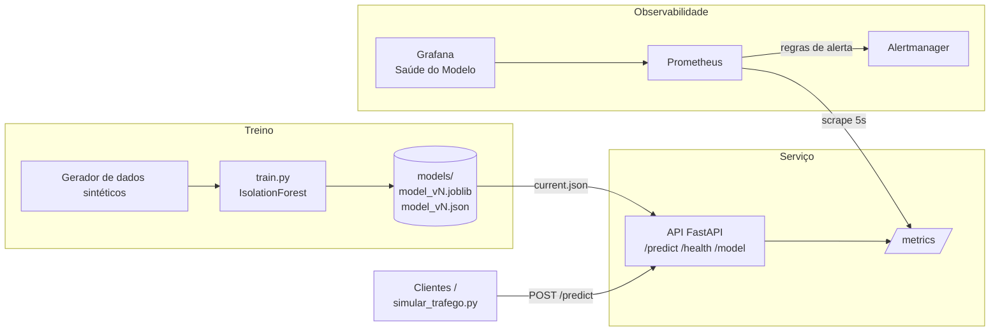

# Detecção de Anomalias como Serviço: mini plataforma de MLOps

<i> Projeto realizado em dois perfis meus no GitHub, este 1° @DaihSeven e o outro 2° @DevDaih [https://github.com/DevDaih/mlops-anomalias.git](https://github.com/DevDaih/mlops-anomalias.git) </i>

Plataforma de MLOps de ponta a ponta construída em torno de um modelo leve de detecção de anomalias. O foco não é o modelo em si, e sim o que uma equipe de MLOps constrói ao redor dele: treino reprodutível, versionamento, serviço via API, monitoramento de desempenho e de desvio dos dados (drift), alertas e, nas próximas etapas, pipeline de CI/CD com retreino agendado e portão de qualidade.

Tudo roda localmente, inclusive num GitHub Codespace de 2 núcleos, sem nenhum provedor de IA externo e sem custo.

> ⚠️ **Aviso sobre os dados**
> Todos os dados deste projeto são **sintéticos**, gerados por código em `src/anomalias/data.py`. Eles simulam leituras de sensores industriais (`temperature` em °C, `pressure` em bar, `vibration` em mm/s e `current` em A) com anomalias injetadas de forma controlada. Como os rótulos das anomalias são conhecidos, é possível medir a qualidade do modelo, mas os números refletem esse cenário simulado, **não um ambiente de produção real**.

## Objetivo

- Treinar um modelo `IsolationForest` (scikit-learn) em segundos e medir sua qualidade com precisão, recall e F1 sobre anomalias conhecidas.
- Versionar cada modelo treinado junto com seus hiperparâmetros, métricas e estatísticas de referência dos dados.
- Servir o modelo numa API FastAPI.
- Expor métricas operacionais e de modelo para o Prometheus: latência, volume, taxa de anomalias e drift.
- Visualizar a saúde do modelo no Grafana e disparar alertas pelo Alertmanager quando o modelo começar a se degradar.

## Dados sintéticos

Cada leitura tem quatro features:

| Feature | Unidade | Média | Desvio padrão |
|---------|---------|-------|---------------|
| `temperature` | °C | 70 | 5 |
| `pressure` | bar | 5 | 0,5 |
| `vibration` | mm/s | 2 | 0,4 |
| `current` | A | 15 | 2 |

Os pontos normais vêm de uma normal multivariada com **correlação leve** entre as features: temperatura acompanha a corrente (0,40) e vibração acompanha a pressão (0,30). As demais correlações ficam entre 0,05 e 0,15.

Uma fração dos pontos (`contamination`, 5% por padrão) vira anomalia, de três tipos:

- **`spike`**: uma única feature salta de 6 a 10 desvios padrão, para cima ou para baixo.
- **`out_of_range`**: de duas a quatro features saem da faixa ao mesmo tempo, de 4 a 7 desvios padrão.
- **`improbable_combo`**: temperatura alta, corrente baixa e vibração alta (3 a 5 desvios cada). Os valores isolados não são absurdos, mas a combinação contraria a correlação dos dados normais.

As estatísticas de referência para o drift (média e desvio de cada feature) são calculadas só com os pontos de treino que o modelo classificou como normais, sem usar os rótulos. Assim as anomalias não inflam o desvio de referência.

## Arquitetura



**Fluxo resumido:** o script de treino gera os dados, treina o modelo, avalia e salva uma nova versão em `models/`. O arquivo `current.json` indica qual versão está ativa. A API carrega essa versão, responde às predições e registra métricas. O Prometheus coleta essas métricas, avalia as regras de alerta e envia os alertas ao Alertmanager. O Grafana exibe tudo num dashboard provisionado automaticamente.

### Estrutura do repositório

```
src/anomalias/      geração de dados, treino, versionamento e cálculo de drift
api/                API FastAPI e métricas Prometheus
models/             artefatos versionados (model_vN.joblib + model_vN.json)
monitoring/         configuração do Prometheus, Grafana e Alertmanager
scripts/            simulador de tráfego e scripts operacionais
tests/              testes com pytest
```

## Como rodar

### Pré-requisitos

Docker e Docker Compose. No GitHub Codespaces, o `devcontainer.json` já instala tudo.

### Subir o stack completo

Crie o arquivo `.env` com a senha do Grafana (ele está no `.gitignore` e **nunca** deve ser commitado):

```bash
cp .env.example .env   # edite e troque o placeholder por uma senha sua
docker compose up -d --build
```

O compose se recusa a subir se `GF_SECURITY_ADMIN_PASSWORD` não estiver definida. A imagem da API treina um modelo na build (seed 42, dados sintéticos), então não precisa de volume nem de treino prévio. Limites de memória: api 256m, prometheus 256m, grafana 256m, alertmanager 64m; o Prometheus guarda 2 dias de dados.

| Serviço      | Porta | Endereço local           |
|--------------|-------|--------------------------|
| API          | 8000  | http://localhost:8000/docs |
| Prometheus   | 9090  | http://localhost:9090    |
| Grafana      | 3000  | http://localhost:3000    |
| Alertmanager | 9093  | http://localhost:9093    |

No Codespaces, acesse pela aba **Ports**. No Grafana, entre com o usuário `admin` e a senha do `.env`; acesso anônimo e cadastro estão desligados. O datasource (`uid: prometheus`) e o dashboard **Saúde do Modelo** são provisionados automaticamente.

### Treinar um novo modelo

```bash
pip install -r requirements-dev.txt   # runtime + pytest, httpx, ruff
pip install -e .
python -m anomalias.train --n-samples 5000 --contamination 0.05 --seed 42
```

Cada execução cria uma nova versão em `models/` e atualiza `models/current.json`. Use `--no-activate` para salvar sem ativar e `python -m anomalias.train --help` para ver todas as opções. Os artefatos de `models/` são gerados localmente e não vão para o git.

### Fazer uma predição

```bash
curl -X POST http://localhost:8000/predict \
  -H "Content-Type: application/json" \
  -d '{"temperature": 70.2, "pressure": 5.1, "vibration": 2.1, "current": 15.3}'
```

### Simular tráfego (normal e com drift)

```bash
# tráfego normal (~5% de anomalias), 60 s a 10 req/s
python scripts/simular_trafego.py --mode normal --duration 60 --rps 10

# drift gradual: temperature desliza até 1,5 desvio em 30 s (use --features current para somar outra)
python scripts/simular_trafego.py --mode drift --duration 90 --rps 10 --ramp 30 --shift 1.5

# rajada de anomalias (40%) no terço central da duração
python scripts/simular_trafego.py --mode burst --duration 90 --rps 10 --anomaly-rate 0.4
```

O simulador lê as `reference_stats` de `GET /model`, gera os registros em torno delas e, ao final, imprime enviados, erros e latência p50/p95 medida no cliente. Os parâmetros são `--url`, `--mode`, `--duration`, `--rps`, `--seed`, `--ramp`, `--shift`, `--features` e `--anomaly-rate`.

> **Capacidade:** cada requisição executa duas travessias das 200 árvores (~36 ms), então um worker satura perto de 25 req/s. Acima disso a latência explode e o alerta `LatenciaP95Alta` dispara de verdade.

### Rodar os testes e o lint

```bash
pytest
ruff check .
```

## Métricas expostas

Disponíveis em `GET /metrics`, no formato do Prometheus.

| Métrica | Tipo | Descrição |
|---------|------|-----------|
| `anomaly_api_requests_total` | Counter | Requisições por endpoint e status |
| `anomaly_api_request_latency_seconds` | Histogram | Latência das requisições (base para p50, p95, p99) |
| `anomaly_api_predictions_total` | Counter | Total de registros avaliados |
| `anomaly_api_anomalies_total` | Counter | Total de registros classificados como anomalia |
| `anomaly_api_anomaly_ratio` | Gauge | Proporção de anomalias nas últimas 500 predições |
| `anomaly_api_drift_score` | Gauge | Drift por feature (label `feature`) |
| `anomaly_api_drift_score_max` | Gauge | Maior drift entre as features |
| `anomaly_api_model_version` | Gauge | Versão do modelo em uso (label `version`) |

### Como o drift é medido

Para cada feature, o drift é calculado como:

```
drift = |média da janela recente − média do treino| / desvio padrão do treino
```

A janela recente contém os últimos 500 registros recebidos pela API, e as estatísticas de treino ficam salvas no `model_vN.json` de cada versão. Um valor de 0,5 significa que a média dos dados recebidos se afastou meio desvio padrão da média vista no treino.

É uma medida propositalmente simples. Ela detecta deslocamentos de média, mas não detecta mudanças na forma da distribuição, na variância isolada ou nas correlações entre features. Testes estatísticos como Kolmogorov–Smirnov ou PSI seriam evoluções naturais.

## Alertas

Definidos em `monitoring/prometheus/alerts.yml` e encaminhados ao Alertmanager.

| Alerta | Condição | Duração | Severidade |
|--------|----------|---------|------------|
| `DriftAlto` | `drift_score_max > 0.5` | 1 min | warning |
| `DriftCritico` | `drift_score_max > 1.0` | 1 min | critical |
| `TaxaAnomaliaAlta` | `anomaly_ratio > 0.15` | 2 min | warning |
| `LatenciaP95Alta` | p95 > 200 ms | 2 min | warning |
| `ApiFora` | `up == 0` | 30 s | critical |

Por padrão, os alertas ficam visíveis na interface do Alertmanager. O arquivo `alertmanager.yml` traz um exemplo comentado de como enviar notificações para um webhook gratuito do Discord.

## Resultados

Números medidos neste ambiente, sem estimativas. Os valores marcados como _a medir_ ainda não foram coletados.

**Ambiente do teste:** _a medir_ (por exemplo, GitHub Codespace com 2 núcleos e 8 GB de RAM)

### Qualidade do modelo (conjunto de teste sintético)

| Versão | Precisão | Recall | F1 | Tempo de treino |
|--------|----------|--------|----|-----------------|
| v2 | 0,935 | 0,960 | 0,947 | 2,2 s |

Fonte: `models/model_vN.json`. Treino com 5000 amostras, 5% de anomalias e seed 42 (3500 para treino, 1500 para teste). O tempo de treino é o tempo total do comando `python -m anomalias.train`, incluindo geração dos dados e gravação do modelo.

### Desempenho da API e detecção de drift

Teste com `simular_trafego.py`: 3 minutos em modo normal seguidos de 3 minutos em modo drift.

| Indicador | Fase normal | Fase com drift |
|-----------|-------------|----------------|
| Requisições por segundo | _a medir_ | _a medir_ |
| Latência p95 | _a medir_ | _a medir_ |
| Taxa de anomalias | _a medir_ | _a medir_ |
| Drift máximo | _a medir_ | _a medir_ |
| Alertas disparados | _a medir_ | _a medir_ |

Consultas usadas no Prometheus:

```promql
histogram_quantile(0.95, sum(rate(anomaly_api_request_latency_seconds_bucket[1m])) by (le))
anomaly_api_anomaly_ratio
max_over_time(anomaly_api_drift_score_max[3m])
ALERTS{alertstate="firing"}
```

## Próximas etapas

- **Etapa 2:** CI com GitHub Actions (testes, lint e build da imagem publicada no GHCR), retreino agendado com portão de qualidade que só promove um novo modelo se o F1 não piorar, infraestrutura como código com Terraform (provider Docker) e scripts Bash de teste pós-deploy e relatório diário de saúde do modelo.
- **Etapa 3 (opcional):** implantação num cluster kind com Helm e registro dos experimentos no MLflow.

## Tecnologias

Python, scikit-learn, FastAPI, Prometheus, Grafana, Alertmanager, Docker e Docker Compose. Nas próximas etapas: GitHub Actions, Terraform, Bash, Kubernetes (kind), Helm e MLflow.
