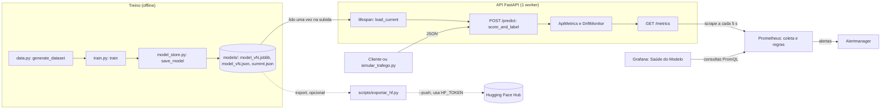
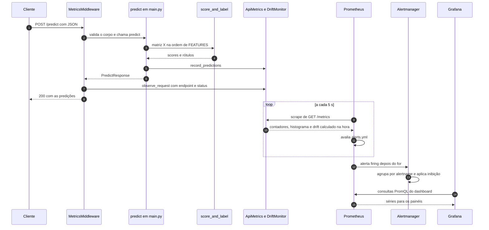

# Arquitetura do projeto

Este documento explica como o projeto funciona por dentro, com base no código que existe no repositório. Para os números medidos e as capturas de tela, veja o [README](../README.md).

> ⚠️ **Aviso sobre os dados**
> Todos os dados do projeto são **sintéticos**, gerados por `src/anomalias/data.py`. Os rótulos das anomalias são conhecidos porque foram injetados por código. Qualquer métrica citada aqui vale para esse cenário simulado, não para um ambiente real.

**De onde vêm os números.** Este documento não tem números escritos à mão. Os valores de qualidade e de medição vêm da seção "Resultados" do README ou do `models/model_v1.json`. Esse JSON é gerado localmente pelo treino e fica fora do git (`.gitignore` ignora `models/*.json` e `models/*.joblib`). Constantes de código (tamanho da janela, limites do lote etc.) são citadas com o arquivo onde estão definidas, e limiares de alerta vêm de `monitoring/prometheus/alerts.yml`.

## Sumário

1. [Visão geral e objetivo](#1-visão-geral-e-objetivo)
2. [Mapa do repositório](#2-mapa-do-repositório)
3. [Dados sintéticos](#3-dados-sintéticos)
4. [Treino e versionamento](#4-treino-e-versionamento)
5. [API](#5-api)
6. [Monitoramento](#6-monitoramento)
7. [Alertas](#7-alertas)
8. [Infraestrutura](#8-infraestrutura)
9. [CI/CD](#9-cicd)
10. [Publicação do modelo](#10-publicação-do-modelo)
11. [Fluxo de uma requisição](#11-fluxo-de-uma-requisição)
12. [Decisões de projeto e trade-offs](#12-decisões-de-projeto-e-trade-offs)
13. [Limitações conhecidas e não implementado](#13-limitações-conhecidas-e-não-implementado)
14. [Como estender](#14-como-estender)

---

## 1. Visão geral e objetivo

**O que é.** Um detector de anomalias (`IsolationForest` do scikit-learn) treinado com dados sintéticos de quatro sensores industriais, servido por uma API FastAPI e observado por Prometheus, Grafana e Alertmanager. O foco do projeto não é o modelo, e sim o que se constrói ao redor dele: treino reprodutível, versionamento em disco, API com métricas, monitoramento de drift, alertas, imagem Docker, CI e publicação do modelo já treinado no Hugging Face Hub.

**O que não é.**

- Não é um detector validado em dados reais. Os dados são sintéticos e o problema é fácil por construção (o README, em "Limitações", explica por que o ROC-AUC alto não indica desempenho real).
- Não é uma plataforma completa de MLOps: não há retreino agendado, portão de qualidade, Terraform nem recarga a quente (veja a [seção 13](#não-implementado)).
- Não depende de nenhum serviço externo em execução. A única exceção, descrita no `CLAUDE.md`, é opcional e fica fora da API: publicar o modelo treinado no Hugging Face Hub com `scripts/exportar_hf.py --push`.

### Diagrama da arquitetura geral



---

## 2. Mapa do repositório

| Caminho | Papel |
|---|---|
| `src/anomalias/data.py` | Gerador de dados sintéticos (`generate_dataset`) e constantes das features. |
| `src/anomalias/train.py` | Treino, métricas, `reference_stats`, `score_and_label` e CLI (`python -m anomalias.train`). |
| `src/anomalias/model_store.py` | Versionamento em disco: `save_model`, `load_current`, `list_versions`. |
| `src/anomalias/drift.py` | `DriftMonitor`: janela deslizante e cálculo do drift. |
| `api/main.py` | Aplicação FastAPI: `lifespan`, `/health`, `/model`, `/predict`, `/metrics`. |
| `api/metrics.py` | `ApiMetrics` (registry próprio), `_DriftCollector` e `MetricsMiddleware`. |
| `api/schemas.py` | Schemas de entrada e saída (Pydantic). |
| `models/` | Artefatos gerados localmente: `model_vN.joblib`, `model_vN.json`, `current.json`. Só `.gitkeep` vai para o git. |
| `monitoring/prometheus/` | `prometheus.yml` (coleta) e `alerts.yml` (regras). |
| `monitoring/alertmanager/alertmanager.yml` | Roteamento e regra de inibição. |
| `monitoring/grafana/` | Provisionamento do datasource e do dashboard, e o JSON `saude-do-modelo.json`. |
| `scripts/simular_trafego.py` | Simulador de tráfego sintético (modos `normal`, `drift`, `burst`). |
| `scripts/exportar_hf.py` | Exporta o modelo ativo para skops e, com `--push`, publica no Hub. |
| `hf/MODEL_CARD.md` | Modelo do cartão do Hugging Face, preenchido com os números do JSON. |
| `tests/` | Testes pytest de dados, treino, versionamento, drift, métricas, API, simulador e exportação. |
| `Dockerfile` | Imagem slim da API; treina o modelo na build. |
| `docker-compose.yml` | Stack: API, Prometheus, Alertmanager e Grafana. |
| `.github/workflows/ci.yml` | CI: lint, testes, validação das configs, build, teste do container e push no GHCR. |
| `requirements.txt`, `requirements-dev.txt`, `requirements-hf.txt` | Dependências de runtime, de desenvolvimento e da exportação para o Hub. |
| `.env.example` | Modelo do `.env` (senha do Grafana; `HF_TOKEN` só para publicar). |
| `notebooks/` | Notebook que aplica o mesmo método a um dataset real, executado no Kaggle (veja o README). |
| `docs/` | Imagens usadas no README e este documento. |

---

## 3. Dados sintéticos

Arquivo: `src/anomalias/data.py`. Função principal: `generate_dataset(n_samples, contamination, seed)`, que devolve `X` e `y` (1 = anomalia), já embaralhados.

**Quatro features** (constante `FEATURES`, que é a fonte única dos nomes): `temperature` (°C), `pressure` (bar), `vibration` (mm/s) e `current` (A). Médias em `MEANS` e desvios em `STDS`.

**Correlação leve.** Os dados normais vêm de `rng.multivariate_normal(MEANS, _covariance(), ...)`, com a matriz `CORRELATION`. A mais forte liga temperatura e corrente; vibração acompanha a pressão em menor grau. A covariância é `CORRELATION * outer(STDS, STDS)`. Essa correlação importa porque uma das anomalias a contraria de propósito.

**Três tipos de anomalia** (`ANOMALY_TYPES`, injetados por `_inject_anomalies`, um tipo sorteado por registro):

| Tipo | O que faz |
|---|---|
| `spike` | Uma única feature salta para longe da média, com sinal aleatório. |
| `out_of_range` | Várias features saem da faixa operacional ao mesmo tempo, com sinais aleatórios. |
| `improbable_combo` | Temperatura alta com corrente baixa e vibração alta, contrariando a correlação dos dados normais. Sempre no mesmo sentido. |

Os múltiplos de desvio de cada tipo estão no código (`rng.uniform(...)` em `_inject_anomalies`). Um detalhe que o README explora nos Achados: só `improbable_combo` desloca a média, porque `spike` e `out_of_range` usam sinais aleatórios.

**Seed e proporção.** `rng = np.random.default_rng(seed)` torna a geração determinística. O número de anomalias é `round(n_samples * contamination)`; as primeiras linhas viram anomalias e depois `rng.permutation` embaralha. `contamination` precisa estar em `[0, 0.5)` e `n_samples` deve ser positivo; senão `ValueError`.

Os rótulos conhecidos servem **só para avaliar** o modelo. O `IsolationForest` treina sem `y`.

---

## 4. Treino e versionamento

### `src/anomalias/train.py`

`train()` faz, em ordem:

1. Gera os dados com `generate_dataset` e separa treino e teste com `train_test_split(..., stratify=y)`.
2. Treina `IsolationForest(n_estimators, max_samples, contamination, random_state=seed, n_jobs=1)` só com `X_train`.
3. Calcula a **referência do drift** (próximo tópico).
4. Mede precisão, recall, F1 e ROC-AUC no teste. O ROC-AUC usa `-model.score_samples(X_test)`, porque `score_samples` é maior para pontos normais e a AUC espera "maior = mais anômalo" para o rótulo 1.
5. Devolve o modelo e o dicionário de metadados: `model_type`, `features`, `hyperparams`, `data` (com `"synthetic": True`), `metrics`, `reference_stats`, `reference_n_samples` e `reference_criterion`.

A CLI (`parse_args`, `main`) aceita `--n-samples`, `--contamination`, `--seed`, `--test-size`, `--n-estimators`, `--max-samples`, `--models-dir` e `--no-activate`.

### `reference_stats`: só pontos previstos como normais

```python
X_reference = X_train[predict_labels(model, X_train) == 0]
```

A média e o desvio de referência (`reference_stats`) são calculados apenas com os pontos de treino que **o próprio modelo** classifica como normais. Os rótulos `y` não entram.

**Por que importa.** O drift é `|média da janela − média de referência| / desvio de referência`. Se o desvio de referência incluísse as anomalias, ele ficaria inflado e o mesmo deslocamento real apareceria como um drift menor, o que atrasaria ou evitaria os alertas. O README mede isso no Achado 2 (desvio de 27% a 39% maior com todos os pontos). O campo `reference_criterion: "predicted_normal"` registra o critério usado, e `reference_n_samples` registra quantos pontos formaram a referência.

### `src/anomalias/model_store.py`

Layout de `models/`:

```
model_v1.joblib   modelo serializado
model_v1.json     metadados da versão
current.json      aponta para a versão ativa
```

- **Versão.** `save_model` olha as versões existentes (`_existing_versions`, regex `model_v(\d+).joblib`) e usa a próxima.
- **Ordem de escrita.** Primeiro `joblib.dump`, depois o JSON de metadados e por último o `current.json`. Assim o ponteiro só passa a apontar para uma versão cujos arquivos já existem.
- **Escrita atômica.** `_write_json_atomic` grava em um `.tmp` e troca com `os.replace`, então um leitor nunca vê JSON pela metade. O `joblib.dump` em si não é atômico; a proteção vem da ordem acima.
- **`activate=False`.** Salva a versão mas não altera `current.json`. Na CLI é o `--no-activate`. Hoje nada no repositório usa isso automaticamente: o motivo documentado no docstring é o portão de qualidade do retreino, que não existe ainda.
- **Leitura.** `load_current` lê `current.json`, carrega o `.joblib` e o JSON da versão. `list_versions` devolve os metadados de todas as versões.
- **Diretório.** `MODELS_DIR` (variável de ambiente) ou `models/`.

---

## 5. API

Arquivo: `api/main.py`. Sobe com `uvicorn api.main:app --workers 1` (o motivo está na [seção 6](#por-que-1-worker)).

### Endpoints

| Método e rota | O que faz |
|---|---|
| `GET /health` | `status` (`ok` ou `no_model`), `model_version`, `uptime_seconds` e `detail` (erro de carga, se houver). Responde 200 mesmo sem modelo. |
| `GET /model` | Devolve o JSON de metadados do modelo ativo (inclui métricas e `reference_stats`). 503 sem modelo. |
| `POST /predict` | Classifica um registro ou um lote. 503 sem modelo. |
| `GET /metrics` | Métricas no formato do Prometheus. Fora do OpenAPI (`include_in_schema=False`) e não contado nas próprias métricas. |

### Schema (`api/schemas.py`)

- `SensorRecord` é criado com `create_model` **a partir de `FEATURES`**, então o schema acompanha o gerador sem repetir nomes. Cada campo é `FiniteFloat` (`strict=True`, `allow_inf_nan=False`): rejeita texto e NaN/infinito. `extra="forbid"` rejeita campos desconhecidos.
- `PredictRequest = SensorRecord | SensorBatch`: um objeto ou uma lista de 1 a `MAX_BATCH` registros (constante em `schemas.py`).
- Resposta: `PredictResponse` com uma lista de `Prediction` (`is_anomaly`, `anomaly_score`, `model_version`). `anomaly_score` é `-score_samples`: maior = mais anômalo.
- `validation_error_handler` em `main.py` devolve 422 **sem o campo `input`**. O handler padrão ecoa o valor recebido, e com NaN/Infinity a serialização da resposta quebraria e viraria 500.

### `lifespan`

Na subida, `lifespan` cria `app.state.metrics = ApiMetrics()` e chama `load_current`. Se o modelo carrega, confere que `metadata["features"] == FEATURES` e chama `metrics.set_model(version, reference_stats)`, que inicializa o `DriftMonitor`. O modelo é lido **uma vez**: mudar `current.json` depois não afeta a API em execução.

### Sem modelo

Qualquer exceção na carga (arquivo ausente, features diferentes etc.) é capturada: a API sobe mesmo assim, guarda `load_error`, `/health` mostra `no_model` com o detalhe e `/predict` e `/model` respondem 503 com uma mensagem pedindo treino e reinício. `/metrics` continua funcionando (sem série de versão nem de drift).

### `score_and_label` e o score calculado uma vez

Em `src/anomalias/train.py`:

```python
raw = model.score_samples(X)
return -raw, ((raw - model.offset_) < 0).astype(int)
```

O rótulo é derivado do **mesmo** `score_samples` e é equivalente a `model.predict` (que internamente usa `decision_function = score_samples - offset_`). Chamar `predict` e `score_samples` separadamente percorreria as árvores duas vezes. O `/predict` chama `score_and_label` uma única vez e usa o resultado para a resposta e para as métricas. O ganho medido está no README (Achado 3); `scripts/exportar_hf.py` também usa a função para provar a equivalência do modelo exportado.

`/predict` é uma função síncrona (`def`), executada pelo FastAPI em um pool de threads. Por isso as estruturas de estado compartilhado (`ApiMetrics`, `DriftMonitor`) usam `threading.Lock`.

---

## 6. Monitoramento

Arquivo: `api/metrics.py`.

### Métricas (todas com prefixo `anomaly_api_`)

| Métrica | Tipo | O que mede |
|---|---|---|
| `anomaly_api_requests_total` | Counter | Requisições HTTP por `endpoint` (template da rota) e `status`. |
| `anomaly_api_request_latency_seconds` | Histogram | Latência das requisições por `endpoint`, com buckets `LATENCY_BUCKETS`. |
| `anomaly_api_predictions_total` | Counter | **Registros** avaliados (não requisições). |
| `anomaly_api_anomalies_total` | Counter | Registros marcados como anomalia. |
| `anomaly_api_anomaly_ratio` | Gauge | Proporção de anomalias nas últimas predições (janela `window_size`). |
| `anomaly_api_drift_score` | Gauge (label `feature`) | Drift por feature, calculado na hora do scrape. |
| `anomaly_api_drift_score_max` | Gauge | Maior drift entre as features. |
| `anomaly_api_model_version` | Gauge (label `version`) | Versão ativa; o valor é sempre 1 e a versão vai no label. |

`MetricsMiddleware` (ASGI) mede cada requisição. Usa o **template** da rota (`scope["route"].path`, por exemplo `/predict`) e não a URL crua, para limitar a cardinalidade dos labels; rotas inexistentes viram `endpoint="unmatched"`; `/metrics` fica de fora. Se a aplicação estourar antes de responder, o status registrado é 500.

### `DriftMonitor` (`src/anomalias/drift.py`)

Fórmula, por feature:

```
drift = |média_janela − média_referência| / desvio_referência
```

- **Janela:** `DEFAULT_WINDOW_SIZE = 500`, uma `deque` com `maxlen` dos últimos registros.
- **Mínimo:** `DEFAULT_MIN_SAMPLES = 100`. Com menos registros, `scores()` devolve `None`. O comentário no código explica: o erro padrão da média da janela é cerca de `1/sqrt(n)` desvios, então abaixo desse mínimo o ruído sozinho se aproxima de limiares razoáveis.
- `update(X)` acrescenta registros, `reset()` esvazia, e tudo é protegido por lock.
- **Limitações** (registradas no docstring do módulo): só detecta mudança de **média** (não vê variância, forma da distribuição nem correlação); a janela inclui as anomalias reais do tráfego, que puxam a média, então o drift basal não é zero; o estado é por processo.

### `_DriftCollector`: ausência de dado em vez de valor falso

Um `Gauge` sem labels sempre exporta uma amostra, mesmo que 0. Por isso `drift_score` e `drift_score_max` são emitidos por um `Collector` próprio, calculado a cada scrape: se a janela ainda não tem o mínimo, o collector **não emite nada** e os alertas de drift não disparam com um valor falso logo após a subida.

### Por que o registry é próprio

Cada `ApiMetrics` cria o seu `CollectorRegistry` (não usa o global). Os testes criam um `TestClient` por teste; com o registry global, as métricas se acumulariam entre testes e registrar o mesmo nome duas vezes daria erro. O `lifespan` cria um registry novo a cada subida.

### Por que 1 worker

As janelas de drift e de `anomaly_ratio` vivem na **memória do processo**. Com N workers, cada um veria uma fração do tráfego e o Prometheus coletaria a visão de um worker diferente a cada scrape. O `Dockerfile` e o docstring de `api/main.py` fixam `--workers 1`.

`ApiMetrics.set_model` também zera as janelas e remove a série da versão antiga quando a versão muda. Como a API só carrega o modelo na subida, na prática isso roda uma vez por processo.

---

## 7. Alertas

Regras em `monitoring/prometheus/alerts.yml`. O Prometheus coleta e avalia a cada 5 s (`prometheus.yml`: `scrape_interval` e `evaluation_interval`).

| Alerta | Condição | `for` | Severidade | Observação |
|---|---|---|---|---|
| `DriftAlto` | `anomaly_api_drift_score_max > 0.5` | 1m | warning | Média da janela a mais de meio desvio da referência. |
| `DriftCritico` | `anomaly_api_drift_score_max > 1.0` | 1m | critical | Mais de um desvio. |
| `TaxaAnomaliaAlta` | `anomaly_api_anomaly_ratio > 0.15` | 2m | warning | O basal esperado é a contaminação do tráfego sintético (5%). |
| `LatenciaP95Alta` | `histogram_quantile(0.95, ...)` de `/predict` na janela de 1m `> 0.2` | 2m | warning | Sem tráfego o resultado é NaN, e comparar com NaN é falso, então não dispara. |
| `ApiFora` | `up{job="anomaly-api"} == 0` | 30s | critical | Depende de o `/metrics` não responder. |

**O `for`.** É o tempo contínuo em que a condição precisa ficar verdadeira: o alerta fica *pending* e só vira *firing* depois dele. Por isso o disparo sempre vem depois do cruzamento do limiar.

**Inibição** (`monitoring/alertmanager/alertmanager.yml`): `DriftCritico` é fonte e `DriftAlto` é alvo. Quando o crítico está ativo, o aviso equivalente fica inibido e só o crítico notifica. O agrupamento é por `alertname`. O receiver `default` não tem integração: os alertas só aparecem na UI do Alertmanager (o arquivo traz um exemplo comentado de webhook do Discord, e a URL seria um segredo).

**Como a calibração foi feita.** O que está registrado no repositório (comentário no topo de `alerts.yml`, repetido nas anotações dos alertas): com **tráfego normal sintético e 5% de anomalias** mediu-se o drift basal (percentil 99 e máximo, valores em `alerts.yml`) e o `anomaly_ratio` basal esperado de cerca de 5%; os limiares foram colocados bem acima do basal para não disparar com tráfego normal (o texto de `DriftAlto` diz que 0,5 é mais que o dobro do máximo basal, e o de `TaxaAnomaliaAlta` diz que 0,15 é o triplo do basal). O repositório **não guarda o script** dessa medição, só o resultado. A rodada de Resultados do README mediu o drift basal de novo, com tráfego normal, e ficou abaixo do limiar. Não há garantia de que os limiares valham para dados reais.

---

## 8. Infraestrutura

### `Dockerfile`

- Base `python:3.11-slim`; só dependências de runtime (`requirements.txt`) em camada separada, para aproveitar o cache.
- Copia apenas `src/` e `api/`. Os scripts, os testes e o `hf/` **não** entram na imagem, e o `.dockerignore` também exclui `models/`, `monitoring/`, `docs/` e `.env`.
- **Treina na build**: `python -m anomalias.train --n-samples 5000 --contamination 0.05 --seed 42 --models-dir "$MODELS_DIR"`. A imagem é reproduzível (seed fixa) e sobe sem volume. O README, em Limitações, lista o que ainda não é fixo (dependências transitivas, tag móvel da imagem base, cache de camada).
- Roda como usuário não-root (`appuser`), com `HEALTHCHECK` no `/health` e `--workers 1`.

### `docker-compose.yml`

| Serviço | Imagem | Porta | Limite de memória |
|---|---|---|---|
| `api` | build local | 8000 | `mem_limit: 256m` |
| `prometheus` | `prom/prometheus` (versão fixada no arquivo) | 9090 | `mem_limit: 256m`, retenção de 2 dias |
| `alertmanager` | `prom/alertmanager` (versão fixada) | 9093 | `mem_limit: 64m` |
| `grafana` | `grafana/grafana` (versão fixada) | 3000 | `mem_limit: 256m` |

- **Senha do Grafana por `.env`.** `GF_SECURITY_ADMIN_PASSWORD: ${GF_SECURITY_ADMIN_PASSWORD:?...}` não tem valor padrão: o compose falha se a variável não existir. O `.env` está no `.gitignore` e o `.env.example` traz só um placeholder. Acesso anônimo, cadastro, telemetria e verificação de atualização estão desligados.
- A pasta `models/` da máquina **não** é montada na API: o container usa o modelo treinado na build.
- Volumes nomeados guardam os dados do Prometheus, Alertmanager e Grafana. Configs e dashboards entram como volumes somente leitura.

### Provisionamento do Grafana

- `provisioning/datasources/prometheus.yml`: datasource `Prometheus` com `uid: prometheus`, `access: proxy`, `url: http://prometheus:9090`, padrão e não editável.
- `provisioning/dashboards/dashboards.yml`: provider de arquivos que lê `/var/lib/grafana/dashboards` (`allowUiUpdates: false`).
- `dashboards/saude-do-modelo.json`: dashboard **Saúde do Modelo**, com painéis de versão do modelo, alertas ativos, alertas em andamento, requisições por segundo por status, latência p50/p95/p99 de `/predict`, taxa de anomalias e drift por feature.

---

## 9. CI/CD

Arquivo: `.github/workflows/ci.yml`. Roda em `push` e `pull_request`, com `permissions: contents: read` por padrão.

### Job `checks` (lint, testes e configs)

| Passo | O que garante | O que NÃO garante |
|---|---|---|
| `pip install -r requirements-dev.txt -r requirements-hf.txt` | As dependências instalam em Python 3.11. | Que as dependências transitivas sejam as mesmas de outra execução (não há lockfile com hashes). |
| `ruff check .` e `ruff format --check .` | Lint e formatação do código Python. | Nada sobre o notebook (excluído em `pyproject.toml`). |
| `pytest` | Que os testes do repositório passam. | Que o comportamento valha com dados reais ou sob carga. |
| `docker compose config --quiet` (com `.env` copiado de `.env.example`) | Que o `docker-compose.yml` é válido e interpolável. | Que os serviços subam ou conversem entre si. |
| `promtool check config` e `check rules` | Sintaxe de `prometheus.yml` e `alerts.yml`, com a **mesma imagem** do compose. | Que os limiares estejam certos nem que os alertas disparem como esperado. |
| `amtool check-config` | Sintaxe de `alertmanager.yml`. | Que a inibição funcione na prática. |

### Job `build` (depende de `checks`)

| Passo | O que garante | O que NÃO garante |
|---|---|---|
| `docker build` com tags `latest` e SHA curto | Que a imagem constrói, inclusive o treino na build. | Reprodutibilidade bit a bit (base `python:3.11-slim` é tag móvel). |
| Teste do container | Que o container sobe, `/health` responde em até 30 s e um `/predict` de um registro normal devolve `is_anomaly == false` com `anomaly_score` e `model_version` numéricos. | Detecção de anomalias, `/metrics`, drift, lote, desempenho ou a stack de monitoramento. |
| Logs do container, só em falha | Diagnóstico. | n/a |
| Login e push no GHCR, **só em push na `main`** | Publica a imagem da API (`latest` e SHA). Pull requests apenas constroem e testam. | Que o pacote esteja público; não faz deploy em lugar nenhum. |

O CI não faz deploy e não roda o stack completo (Prometheus, Grafana e Alertmanager não sobem no CI).

---

## 10. Publicação do modelo

Arquivo: `scripts/exportar_hf.py`; modelo de cartão em `hf/MODEL_CARD.md`. Dependências extras em `requirements-hf.txt` (skops e huggingface_hub), fora da imagem da API.

Fluxo de `export()`:

1. `load_current` carrega o modelo ativo.
2. `save_skops` grava `model.skops`.
3. `load_trusting_only_sklearn_numpy` recarrega o arquivo. `get_untrusted_types` lista os tipos que o skops não confia por padrão; se algum estiver **fora de `sklearn` e `numpy`** (`TRUSTED_ROOTS`), levanta `ExportError`. Só então `load(..., trusted=...)`.
4. `check_equivalence` gera dados sintéticos com seed `seed_do_treino + 1`, roda `score_and_label` no modelo original e no recarregado e exige que scores **e** rótulos sejam **idênticos** (`np.array_equal`), não aproximados.
5. Copia o `model_vN.json` e gera o `README.md` do cartão com `render_model_card`. Os números vêm do JSON; um placeholder desconhecido no modelo de cartão é erro.

Sem `--push`, nada sai da máquina (gera só `hf_export/`). Com `--push`, exige `--repo-id` e a variável `HF_TOKEN`; o token nunca é impresso (`_redact` troca por `***`) e não vai para o repositório nem para a imagem.

**Por que skops e não joblib.** Um arquivo joblib é um pickle: carregá-lo pode executar código arbitrário, e quem baixa um modelo publicado teria que confiar cegamente em quem o enviou. O skops permite **inspecionar** quais tipos o arquivo contém antes de carregar e carregar só os confiados, o que é um formato mais adequado para distribuir. A API do projeto continua usando joblib em `model_store.py` porque lê artefatos produzidos por ela mesma (treino local ou na build da imagem), nunca baixados de terceiros.

**A exceção do `CLAUDE.md`.** A regra geral é "sem provedor externo". A exceção permite **publicar** o modelo treinado no Hugging Face Hub com `exportar_hf.py --push`, usando `HF_TOKEN` do ambiente. A API continua sem depender de nenhum serviço externo em execução; o Hub só recebe o modelo já treinado, e o token não entra no repositório nem na imagem Docker.

---

## 11. Fluxo de uma requisição

Do `POST /predict` até o gráfico no Grafana:

1. O cliente (curl ou `scripts/simular_trafego.py`) envia o JSON para `POST /predict`.
2. `MetricsMiddleware` marca o instante inicial e passa a requisição adiante.
3. O FastAPI valida o corpo contra `PredictRequest`. Se inválido, o handler devolve 422 sem o `input`.
4. `predict` pega o modelo do `app.state` (503 se não houver) e monta a matriz `X` na ordem de `FEATURES`.
5. `score_and_label(model, X)` calcula scores e rótulos em uma passada.
6. `ApiMetrics.record_predictions` incrementa `predictions_total` e `anomalies_total`, atualiza a janela de rótulos e o `anomaly_ratio`, e chama `DriftMonitor.update(X)`.
7. A API responde com `PredictResponse`. Ao terminar, o middleware registra `requests_total` e o histograma de latência com o template `/predict` e o status.
8. A cada 5 s o Prometheus faz o scrape de `GET /metrics`. Nessa hora o `_DriftCollector` calcula `drift_score` e `drift_score_max` a partir da janela (e não emite nada se ela tiver menos do que o mínimo).
9. A cada 5 s o Prometheus avalia `alerts.yml`. Quando uma condição fica verdadeira pelo tempo do `for`, o alerta vira *firing* e é enviado ao Alertmanager, que agrupa e aplica a inibição.
10. O Grafana consulta o Prometheus (datasource provisionado) com as expressões PromQL do dashboard **Saúde do Modelo**, e os painéis mostram latência, taxa de anomalias, drift e alertas.



---

## 12. Decisões de projeto e trade-offs

1. **Drift simples, por média.** Escolhi `|Δ média| / desvio` por ser barato (cabe na máquina de 2 núcleos a cada scrape), fácil de explicar e com unidade intuitiva, o que facilita escolher o limiar. O custo: só vê mudança de média. O README mostra um efeito colateral (Achado 5): uma rajada de anomalias do tipo `improbable_combo` desloca a média e dispara `DriftAlto` sem que os dados normais tenham mudado.
2. **Referência só com pontos previstos como normais.** Evita desvio inflado pelas anomalias do treino sem usar rótulos (que em produção não existiriam). O custo é depender do próprio modelo para definir "normal".
3. **Drift calculado no scrape, por um `Collector`.** Permite não emitir nada enquanto a janela é pequena, em vez de exportar um 0 enganoso. O custo é recalcular a média da janela a cada scrape.
4. **Registry Prometheus por instância de `ApiMetrics`.** Isola os testes e permite um estado limpo a cada subida. O custo é não usar o registry global padrão do `prometheus-client`.
5. **1 worker uvicorn.** As janelas ficam em memória e precisam ver todo o tráfego. O custo é a capacidade: o README mede onde 1 worker satura e que, saturado, deixa de completar `/predict` sem disparar alerta (Achado 7).
6. **Treinar o modelo na build da imagem.** A imagem é autossuficiente e reproduzível com seed fixa, sem volume. O custo é que trocar o modelo exige rebuild e reinício, e o cache de camada pode reaproveitar um treino antigo (README, Limitações).
7. **`score_and_label` em vez de `predict` mais `score_samples`.** Uma passada pelas árvores em vez de duas, com o mesmo critério de decisão. O custo é depender do atributo `offset_` do scikit-learn, o que a equivalência testada na exportação ajuda a vigiar.
8. **Joblib na API, skops na publicação.** O joblib é simples para artefatos próprios; o skops é mais seguro para distribuir. O custo é manter dois formatos e uma verificação de equivalência entre eles.
9. **Schema estrito.** `strict=True`, `allow_inf_nan=False` e `extra="forbid"` evitam que NaN, texto ou campos extras cheguem ao modelo ou às métricas. O custo é rejeitar entradas que um cliente "frouxo" mandaria como texto numérico.

---

## 13. Limitações conhecidas e não implementado

### Limitações conhecidas

Resumo; os detalhes e os números estão na seção [Limitações do README](../README.md#limitações) e nos [Achados](../README.md#achados):

- Os alertas de drift e de taxa de anomalias ficam presos sem tráfego, porque os gauges guardam a última janela; só reiniciar a API limpa.
- O `anomaly_ratio` exporta 0 logo após a subida, ao contrário do drift, que some enquanto a janela é pequena.
- O drift só detecta mudança de média, e a janela inclui as anomalias do tráfego.
- O ROC-AUC alto reflete um problema sintético fácil e não indica desempenho real; o notebook aplica o mesmo método a um dataset real, e o README diz que os dois cenários não são comparáveis.
- Sob sobrecarga (40 req/s com 1 worker), a API deixou de completar `/predict` e nenhum alerta disparou; `LatenciaP95Alta` só foi validado até *pending*.
- A reprodutibilidade da imagem é parcial (transitivas, tag móvel, cache de camada).
- Estado por processo: só vale com 1 worker.

### Não implementado

Itens que **não existem** no repositório, mesmo que o README os cite como próximas ideias:

- **Retreino agendado** e **portão de qualidade** (promover um modelo só se o F1 não piorar). O que existe são as peças de base: `activate=False` em `save_model` e `--no-activate` na CLI de treino.
- **Infraestrutura como código com Terraform** (provider Docker). Não há `infra/` no repositório.
- **Scripts Bash** de teste pós-deploy e de relatório diário de saúde do modelo. A pasta `scripts/` só tem os dois scripts Python.
- **Recarga a quente do modelo.** O modelo é carregado uma vez no `lifespan`; nenhum endpoint nem rotina chama `set_model` de novo. Trocar de versão exige reiniciar a API.
- **Notificação real de alertas.** O receiver do Alertmanager não tem integração.
- **Deploy.** O CI publica a imagem no GHCR, mas nada a implanta em um ambiente.

---

## 14. Como estender

### Trocar o modelo

- **Algoritmo:** em `src/anomalias/train.py`, `train()` instancia o `IsolationForest`. Qualquer modelo que tenha `score_samples` e `offset_` funciona com `score_and_label`; outro que não tenha exige ajustar essa função (e `predict_labels`), porque a API e o `exportar_hf.py` dependem dela.
- **Metadados:** `train()` deve continuar devolvendo `features`, `metrics` e `reference_stats`, que a API (`lifespan`, `/model`) e o `DriftMonitor` consomem.
- **Versionamento:** `save_model` já salva o modelo seguinte; a API só enxerga a nova versão depois de reiniciar.
- **Imagem e exportação:** o `Dockerfile` chama `anomalias.train` na build; `exportar_hf.py` usa `save_skops`, que depende de o modelo ser suportado pelo skops.
- **Testes:** `tests/test_train.py`, `tests/test_model_store.py` e `tests/test_exportar_hf.py` cobrem essas peças.

### Adicionar uma feature

1. `src/anomalias/data.py`: acrescente o nome em `FEATURES` e uma posição em `MEANS`, `STDS` e na matriz `CORRELATION` (que precisa continuar quadrada e com a ordem das features). Ajuste `_inject_anomalies`, que usa índices fixos no tipo `improbable_combo` (temperatura, vibração e corrente).
2. `api/schemas.py` e `DriftMonitor` seguem `FEATURES` automaticamente; `reference_stats` em `train.py` também.
3. Retreine: o `lifespan` rejeita um modelo cujas `features` diferem de `FEATURES`, então modelos antigos deixam de carregar (a API sobe no estado "sem modelo").
4. Revise `scripts/simular_trafego.py` (usa `FEATURES`, `MEANS`, `STDS`) e o `hf/MODEL_CARD.md`, que descreve as quatro features em texto.
5. Rode os testes: vários (`tests/test_data.py`, `tests/test_api.py`) assumem as features atuais.

### Adicionar uma métrica

1. Em `api/metrics.py`, crie o objeto dentro de `ApiMetrics.__init__`, com `registry=self.registry` e o prefixo `anomaly_api_` (convenção do `CLAUDE.md`). Se o valor depende de estado calculado na hora do scrape, siga o modelo do `_DriftCollector`.
2. Alimente a métrica no ponto certo: `record_predictions` para algo por registro, `observe_request` ou `MetricsMiddleware` para algo por requisição.
3. Teste em `tests/test_metrics.py` ou `tests/test_api.py` (cada `TestClient` dispara o `lifespan`, que cria um `ApiMetrics` novo).
4. Para visualizar, acrescente um painel em `monitoring/grafana/dashboards/saude-do-modelo.json`; para alertar, uma regra em `monitoring/prometheus/alerts.yml` (o CI valida a sintaxe com `promtool`).
5. Se a métrica entrar na tabela do README, atualize-a.
